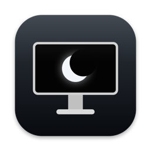
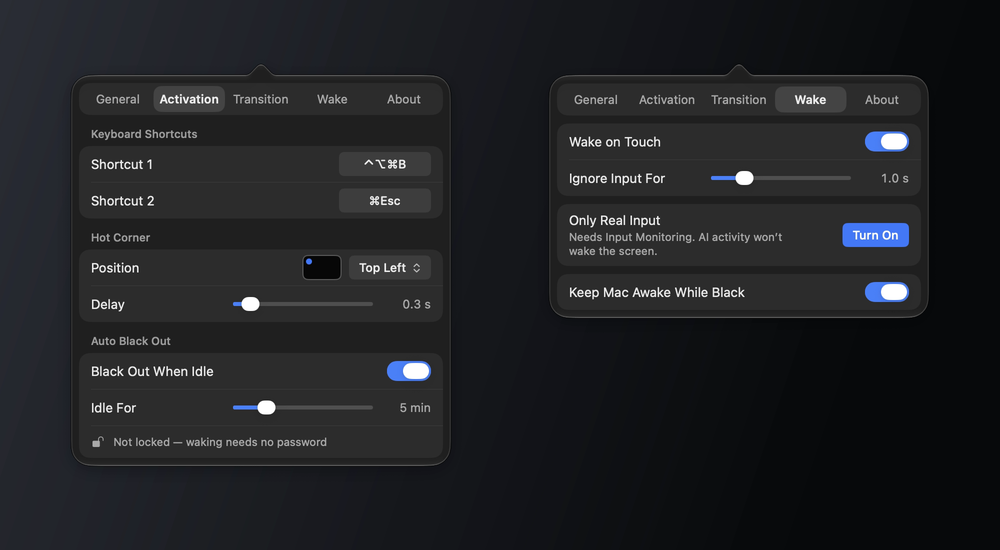
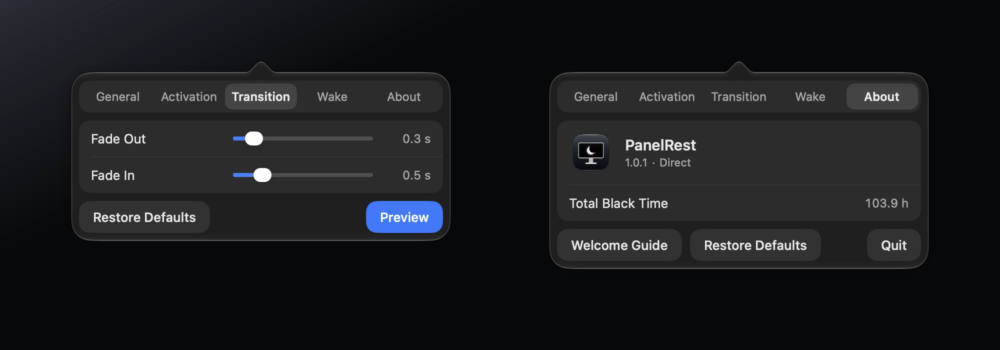

<p align="center">
  
</p>

<h1 align="center">PanelRest</h1>

<p align="center">
  <b>Turn your Mini-LED / OLED display truly black, while your Mac keeps working.</b><br>
  Built for long AI-agent runs, renders and downloads. It wakes only when <i>you</i> touch the mouse or keyboard.
</p>

<p align="center">
  <a href="https://github.com/myyccccc/PanelRest/releases/latest"></a>
  
  
  
  <a href="LICENSE"></a>
</p>

<p align="center">
  English · <a href="README.zh-CN.md">简体中文</a>
</p>

<p align="center">
  
</p>

## Why

You leave an AI agent (Claude, Codex, Cursor…) working overnight, or start a long export. You want the screen **off**: it protects the panel and stops the room from glowing.

But macOS's own "turn display off" **disconnects** the display. When that happens:

- the agent's screenshots and clicks stop working,
- windows get rearranged,
- and the next bump of the mouse by an automation tool lights everything up again.

PanelRest takes a different approach. The display stays connected and the Mac stays awake. Only the picture goes **fully black**. On Mini-LED (Studio Display XDR, Pro Display XDR, MacBook Pro) and OLED panels, black pixels emit no light, so the panel is effectively off.

## Features

- **True black in one keystroke**: `⌃⌥⌘B` or `⌘Esc` (both customizable), a hot corner, or after a set idle time.
- **Wakes only for real humans**: synthetic mouse and keyboard events from AI agents, remote-control tools or scripts are ignored. Your first real touch brings the screen back.
- **Smooth fades**: fade out 0.3 s and fade in 0.5 s by default, both adjustable. Pressing the shortcut again during a fade-in turns it back around.
- **Keeps the Mac awake** while black, so agents and downloads don't pause.
- **Control Center button** (macOS 26): add "Black Out Now" to Control Center or the menu bar.
- **Lives in the menu bar**: no Dock icon; settings open from a native Liquid Glass popover.
- **8 languages**: English, 简体中文, 繁體中文, 日本語, 한국어, Deutsch, Français, Español.
- **Private by design**: no network access, no analytics, no account.
- **Free and open source** (MIT).

<p align="center">
  
</p>

## Install

**Download**: get `PanelRest.dmg` from the [latest release](https://github.com/myyccccc/PanelRest/releases/latest). It is signed with Developer ID and notarized by Apple. Open it and drag PanelRest into Applications.

**Mac App Store**: coming soon (in review).

Requires macOS 14 Sonoma or later. The Control Center button needs macOS 26.

> **Tip:** To make "wakes only for you" also work with the keyboard, allow PanelRest in
> *System Settings › Privacy & Security › Input Monitoring*. Without it, PanelRest still tells real mouse input
> from synthetic input, but key presses can't wake the screen.

## Which displays work?

| Display | Result |
|---|---|
| Mini-LED: Studio Display XDR, Pro Display XDR, MacBook Pro 14"/16" (2021+) | ✅ Local-dimming zones switch off, so the panel is truly black |
| OLED monitors | ✅ Pixels switch off |
| Regular LCD | ⚠️ The picture is black, but the backlight still glows (the direct download also turns brightness down where macOS allows it) |

## How it works

PanelRest is a small SwiftUI + AppKit menu bar app. The interesting parts:

- **Black without disconnecting**: `CGSetDisplayTransferByFormula` maps every output value to 0, so the display keeps showing a frame, but it is all black. The gamma table is re-applied every second because ColorSync and Night Shift can reset it. If the app quits or crashes, macOS restores gamma automatically, so you can't get stuck in the dark.
- **Telling humans from agents**: a listen-only `CGEventTap` reads `eventSourceUnixProcessID`. Hardware events come from PID 0, while synthetic events carry the posting process's PID. On top of that, `IOHIDManager` must see a signal from a real physical device within 0.5 s:
  - virtual devices (`Transport = Virtual`) are excluded;
  - Apple trackpad touches arrive on vendor page `0xFF00` and are accepted, so a light swipe is enough to wake.
- **Hot corner that agents can't trigger**: the cursor must sit exactly where the last *real* mouse-move left it, and corners are ignored for 1 s after any programmatic cursor warp.
- **Staying awake**: a `PreventUserIdleDisplaySleep` power assertion is held while the screen is black.
- **Control Center**: a WidgetKit `ControlWidgetButton` extension. It sends a Darwin notification to the running app, or opens `panelrest://blackout` if the app isn't running.

### Two editions, one codebase

| | Mac App Store (`PanelRest`) | Direct download (`PanelRestDirect`) |
|---|---|---|
| Sandbox | Yes | No |
| Black screen | Gamma to zero (public API) | Gamma to zero + backlight to 0 via private `DisplayServices` |
| System hot-corner conflict | Points you to System Settings | Can fix it in one click |
| Launch at login | Off by default (App Review 2.4.5) | On by default |

The two editions are separated by the `APPSTORE` compilation condition. Private API calls live only in `#if !APPSTORE` blocks.

## Build from source

```bash
brew install xcodegen
git clone https://github.com/myyccccc/PanelRest.git
cd PanelRest
xcodegen generate
xcodebuild -project PanelRest.xcodeproj -scheme PanelRestDirect -configuration Release \
  -derivedDataPath build CODE_SIGN_IDENTITY=- CODE_SIGN_STYLE=Manual DEVELOPMENT_TEAM= \
  PROVISIONING_PROFILE_SPECIFIER= build
open build/Build/Products/Release/PanelRest.app
```

To sign with your own Apple Developer account, change `DEVELOPMENT_TEAM` and `bundleIdPrefix` in `project.yml`.

Useful launch arguments:

| Argument | What it does |
|---|---|
| `--selftest 3` | Go black for 3 s, fade back in, then quit |
| `--settings` | Open the settings popover on launch |
| `--onboarding` | Show the welcome guide again |

Translations live in `scripts/i18n/translations.py`. Running `python3 scripts/i18n/build_catalog.py` regenerates `Localizable.xcstrings`.

## Contributing

Issues and pull requests are welcome: bug reports, new languages, display compatibility notes, ideas.

If PanelRest saves your panel (or your electricity bill), a ⭐ helps other people find it.

## License

[MIT](LICENSE)
