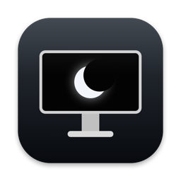
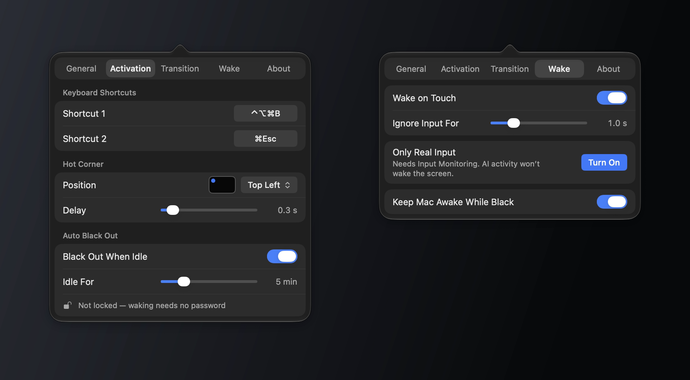
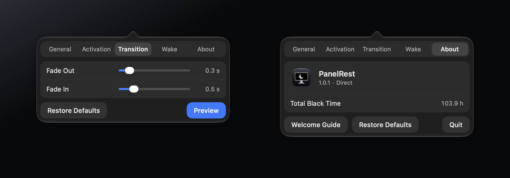

<p align="center">
  
</p>

<h1 align="center">PanelRest</h1>

<p align="center">
  <b>让 Mini-LED / OLED 屏幕彻底黑下来，Mac 照常工作。</b><br>
  适合让 AI 代理、渲染、下载在后台长时间运行。只有<i>你本人</i>碰鼠标或键盘，屏幕才会亮起。
</p>

<p align="center">
  <a href="https://github.com/myyccccc/PanelRest/releases/latest"></a>
  
  
  <a href="LICENSE"></a>
</p>

<p align="center">
  <a href="README.md">English</a> · 简体中文
</p>

<p align="center">
  
</p>

## 为什么做这个

你让 AI 代理（Claude、Codex、Cursor……）通宵干活，或者开始导出一个很长的视频，这时会想把屏幕关掉：保护面板，房间也不会一直亮着。

但 macOS 自带的「关闭显示器」会让显示器**断开**。断开之后：

- AI 的截图和点击都会失效；
- 窗口位置会被打乱；
- 自动化工具一动鼠标，屏幕又亮了。

PanelRest 的做法不一样：显示器保持连接，Mac 保持唤醒，只是画面变成**全黑**。Mini-LED（Studio Display XDR、Pro Display XDR、MacBook Pro）和 OLED 屏显示黑色时像素不发光，效果等于把屏幕关了。

## 功能

- **一键纯黑**：用快捷键 `⌃⌥⌘B` 或 `⌘Esc`（都可自定义）、触发角，或者空闲一段时间后自动黑屏。看视频时（Safari、Chrome 里的 YouTube，IINA、QuickTime 等）不会自动黑屏。
- **只认真人**：AI 代理、远程控制、脚本发出的模拟鼠标键盘事件一律不理会；你亲手碰第一下，屏幕就亮。
- **平滑渐变**：默认 0.3 秒熄灭、0.5 秒点亮，都可以调；渐亮途中再按快捷键，会立刻掉头变回黑屏。
- **黑屏期间 Mac 不睡眠**，AI 和下载不会中断。
- **控制中心按钮**（macOS 26 起）：可以把「立即黑屏」加到控制中心或菜单栏。
- **只在菜单栏**：没有 Dock 图标，设置面板从菜单栏弹出，是系统原生的液态玻璃效果。
- **8 种语言**：简体中文、繁體中文、English、日本語、한국어、Deutsch、Français、Español。
- **不联网**：没有统计，不需要账号。
- **完全免费、开源**（MIT 许可）。

<p align="center">
  
</p>

## 安装

- **下载**：到 [最新版本](https://github.com/myyccccc/PanelRest/releases/latest) 下载 `PanelRest.dmg`。安装包用 Developer ID 签名，并已通过苹果公证。打开后把 PanelRest 拖进「应用程序」即可。
- **Mac App Store**：正在审核，即将上架。

需要 macOS 14 Sonoma 或更新版本；控制中心按钮需要 macOS 26。

> **提示**：要让键盘也遵守「只认真人」，请在「系统设置 › 隐私与安全性 › 输入监控」里允许 PanelRest。
> 不开这个权限也能区分真实鼠标和模拟鼠标，但按键无法唤醒屏幕。

## 支持哪些屏幕

| 屏幕 | 效果 |
|---|---|
| Mini-LED：Studio Display XDR、Pro Display XDR、MacBook Pro 14/16 英寸（2021 年起） | ✅ 分区背光熄灭，真正全黑 |
| OLED 显示器 | ✅ 像素不发光 |
| 普通 LCD | ⚠️ 画面是黑的，但背光还亮着（直装版会在系统允许时顺便调低亮度） |

## 实现原理

- **黑屏但不断开**：用 `CGSetDisplayTransferByFormula` 把所有输出值映射为 0。显示器仍在显示画面，只是全黑。
  - 每秒重新设置一次，因为 ColorSync 和夜览会把它重置。
  - App 退出或崩溃时，系统会自动恢复 gamma，所以不会一直黑着回不来。
- **区分真人和 AI**：
  - 只监听不拦截的 `CGEventTap` 读取 `eventSourceUnixProcessID`。硬件事件的进程号是 0，模拟事件带着发出它的进程号。
  - 再由 `IOHIDManager` 确认 0.5 秒内真的有物理设备发出信号。虚拟设备（`Transport = Virtual`）不算；苹果触控板的触摸走厂商页 `0xFF00`，也算在内，所以轻扫一下就能唤醒。
- **AI 触发不了的触发角**：光标必须停在最后一次*真实*移动留下的位置；程序移动过光标后的 1 秒内，触发角不响应。
- **不睡眠**：黑屏期间持有 `PreventUserIdleDisplaySleep` 电源断言。
- **控制中心**：用 WidgetKit 的 `ControlWidgetButton` 扩展实现。App 在运行时发 Darwin 通知，不在运行时打开 `panelrest://blackout`。

### 两个版本，同一套代码

| | Mac App Store 版（`PanelRest`） | 直装版（`PanelRestDirect`） |
|---|---|---|
| 沙盒 | 是 | 否 |
| 黑屏方式 | gamma 全黑（公开 API） | gamma 全黑 + 用私有 `DisplayServices` 把背光调到 0 |
| 和系统触发角冲突 | 引导你去系统设置修改 | 一键改好 |
| 开机自启 | 默认关（审核规则 2.4.5） | 默认开 |

两个版本用编译条件 `APPSTORE` 区分，私有 API 只写在 `#if !APPSTORE` 里。

## 从源码编译

```bash
brew install xcodegen
git clone https://github.com/myyccccc/PanelRest.git
cd PanelRest
xcodegen generate
xcodebuild -project PanelRest.xcodeproj -scheme PanelRestDirect -configuration Release \
  -derivedDataPath build CODE_SIGN_IDENTITY=- CODE_SIGN_STYLE=Manual DEVELOPMENT_TEAM= \
  PROVISIONING_PROFILE_SPECIFIER= build
open build/Build/Products/Release/PanelRest.app
```

要用自己的开发者账号签名，请修改 `project.yml` 里的 `DEVELOPMENT_TEAM` 和 `bundleIdPrefix`。

常用启动参数：

| 参数 | 作用 |
|---|---|
| `--selftest 3` | 黑屏 3 秒后渐亮并退出 |
| `--settings` | 启动时弹出设置面板 |
| `--onboarding` | 重新显示欢迎引导 |

翻译表在 `scripts/i18n/translations.py`，运行 `python3 scripts/i18n/build_catalog.py` 生成 `Localizable.xcstrings`。

## 参与

欢迎提交 Issue 和 Pull Request，比如 bug 反馈、新语言、某款屏幕的兼容情况、新想法。

如果 PanelRest 帮你护住了屏幕（或省了电费），点个 ⭐ 能让更多人看到它。

## 许可

[MIT](LICENSE)
